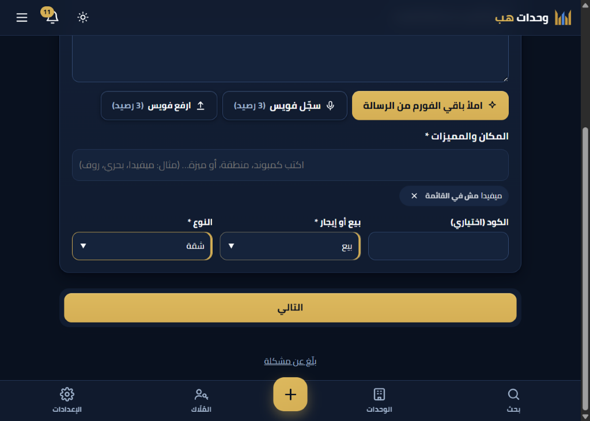
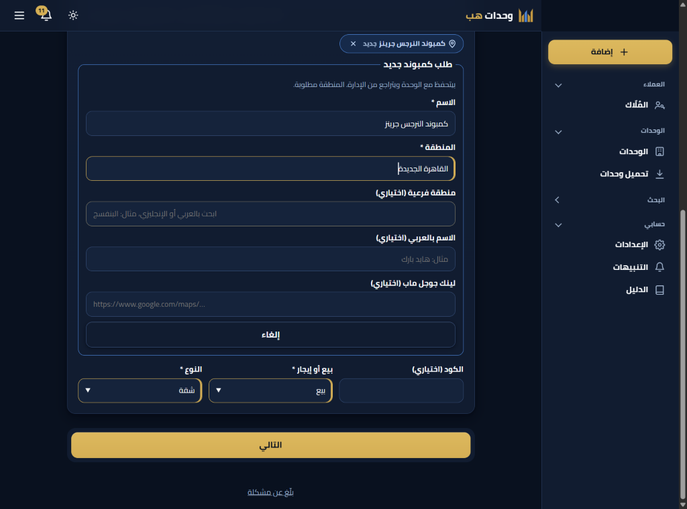
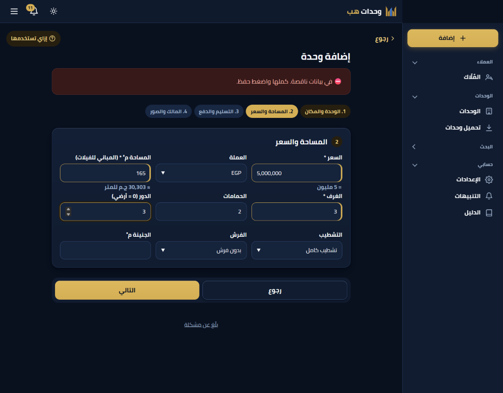
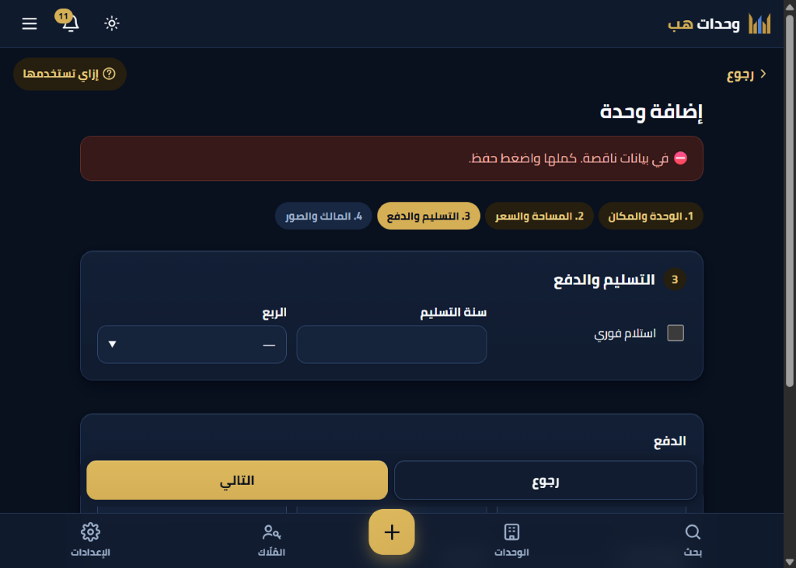
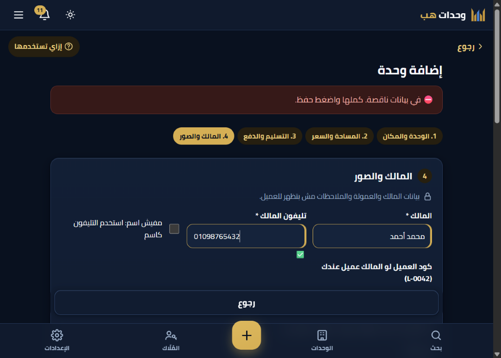
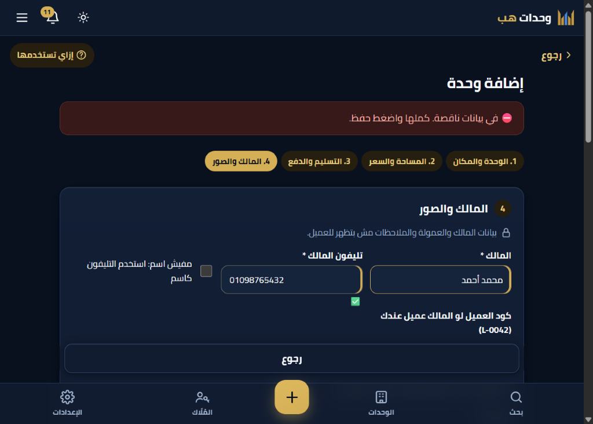
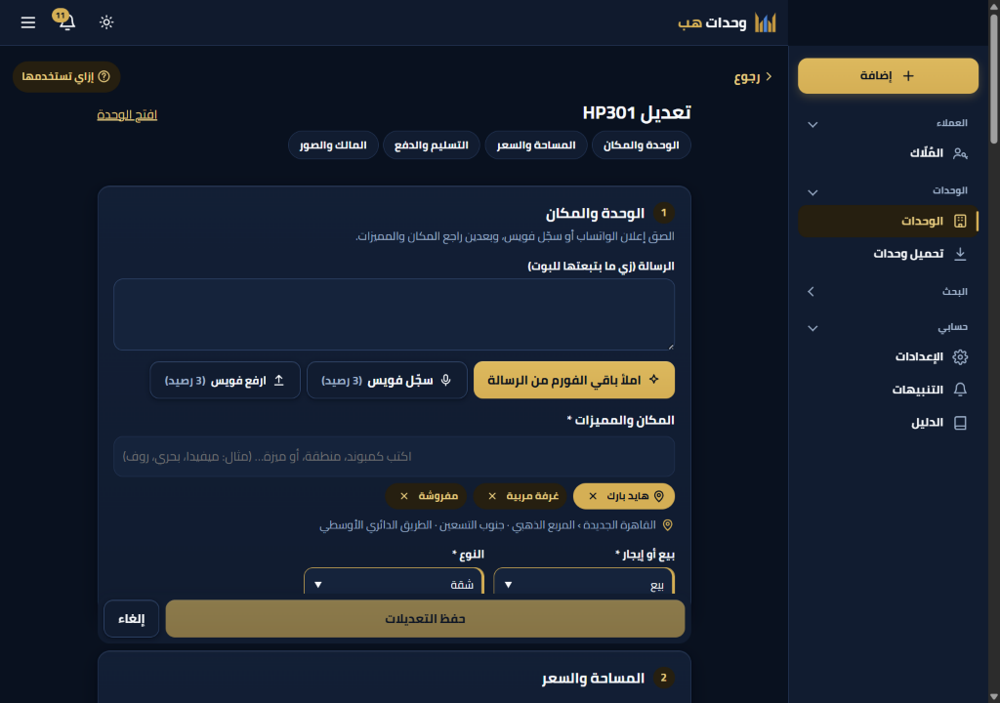
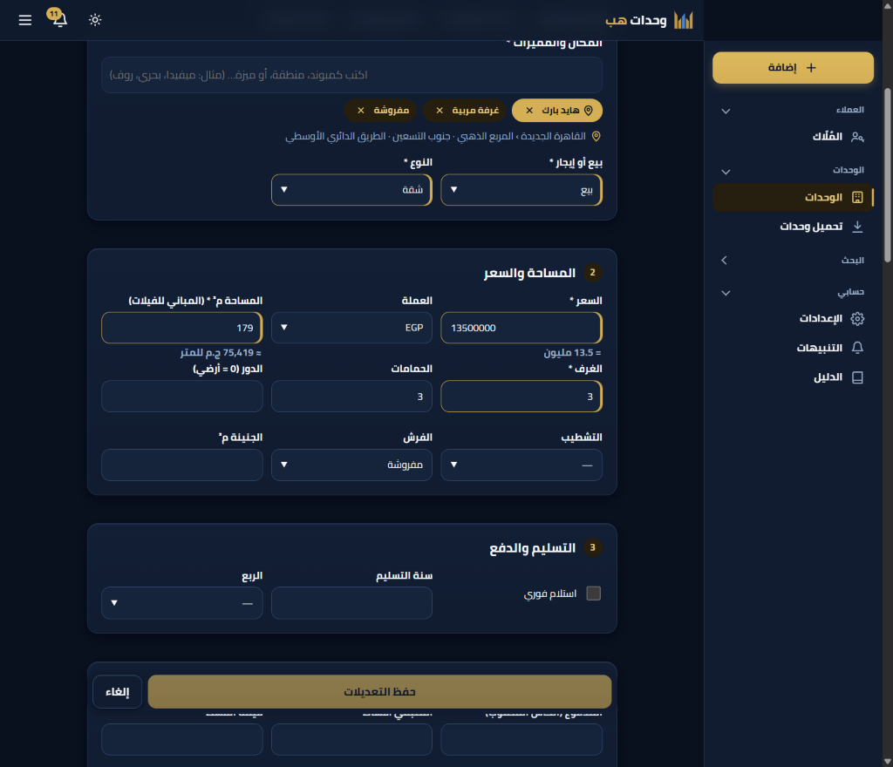
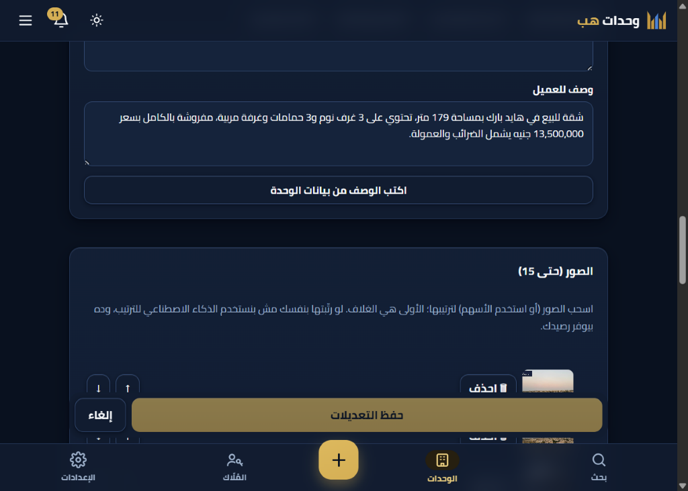
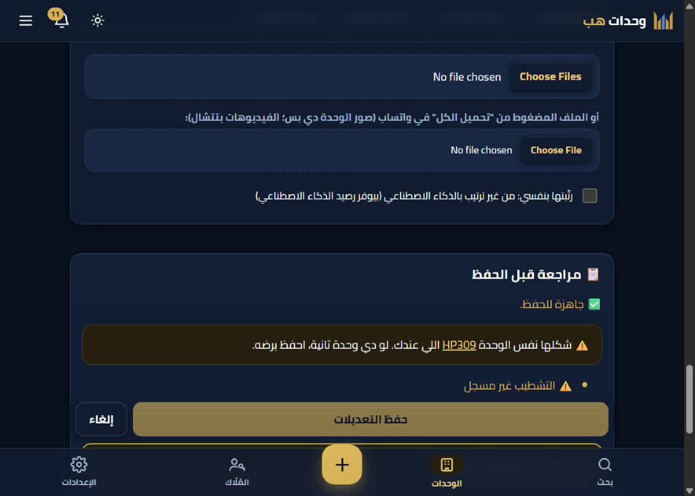

# دليل المبتدئين خطوة بخطوة: إضافة وتعديل الوحدات (شرح مبسط مع أمثلة)

مرحباً بك في دليل موقع **WehdatHub**. صُمم هذا الدليل خصيصاً ليكون سهلاً ومباشراً لأي مستخدم، دون أي تعقيدات تقنية، مع مثال عملي خطوة بخطوة من البداية وحتى حفظ الوحدة بنجاح.

---

## 💡 مثال عملي سنطبقه في هذا الشرح
لنفترض أن لديك وحدة جديدة وتريد إضافتها:
* **نوع الوحدة:** شقة للبيع
* **المكان:** كمبوند هايد بارك (التجمع الخامس - القاهرة الجديدة)
* **المساحة والمواصفات:** 165 متر، 3 غرف، 2 حمام، الدور الثالث، تشطيب كامل، بدون فرش
* **السعر:** 5,500,000 جنيه مصري (كاش، استلام فوري)
* **المالك:** أستاذ محمد أحمد (رقم موبايل: 01012345678)

---

## 🟢 أولاً: خطوات إضافة وحدة جديدة (Add Unit)

افتح صفحة الإضافة بالضغط على **➕ إضافة** أو الدخول على الرابط: `/app/units/new`.  
ستجد نموذجاً مقسماً إلى **4 خطوات متتالية**:

---

### الخطوة 1 من 4: نوع الوحدة والمكان

1. **نوع العرض:**
   * اضغط على **بيع** إذا كانت الوحدة معروضة للبيع (أو **إيجار** إذا كانت للإيجار).
2. **نوع الوحدة:**
   * اختر نوع العقار من القائمة (مثال: **شقة**، أو فيلا، تاون هاوس، دوبلكس...).
3. **خانة المكان والمميزات (الصندوق الموحد):**
   * ابدأ بكتابة اسم الكمبوند أو المنطقة (مثال: اكتب `هايد بارك`).
   * ستظهر لك قائمة اقتراحات فورية توضح المسار الجغرافي (`القاهرة الجديدة › التجمع الخامس › المربع الذهبي`).
   * اضغط على الاقتراح، سيتحول تلقائياً إلى بطاقة زرقاء صغيرة (Chip).
4. **المميزات:**
   * إذا كانت بالوحدة ميزة إضافية، اكتبها في نفس الخانة (مثال: `غرفة مربية` أو `بحري`) واضغط عليها لتضاف كميزة.
5. اضغط على زر **التالي** الأزرق في أسفل الشاشة.

> ### 📍 ماذا لو لم تجد اسم الكمبوند في القائمة؟ (طلب كمبوند جديد)
> إذا كان الكمبوند جديداً وغير مسجل بالنظام (مثال: `كمبوند النرجس جرينز`):
> 1. اكتب اسم الكمبوند في خانة المكان.
> 2. في أسفل قائمة الاقتراحات اضغط على: **«اطلب مكان جديد: كمبوند النرجس جرينز»**.
> 3. ستفتح لك استمارة طلب كمبوند جديد لتعبئة الحقول:
>    * **الاسم \*:** اسم الكمبوند تلقائياً.
>    * **المنطقة \* (إجباري):** اختر المنطقة الرئيسية (مثال: `القاهرة الجديدة` أو `الشيخ زايد`).
>    * **منطقة فرعية (اختياري):** اختر الحي التابع له إن وجد (مثال: `النرجس`).
>    * **الاسم بالعربي (اختياري):** اسم الكمبوند بالعربية.
>    * **لينك جوجل ماب (اختياري):** رابط موقع الكمبوند على خرائط جوجل.
> 4. يتم حفظ الكمبوند فوراً مع وحدتك وتستمر بالخطوة التالية بشكل طبيعي!
>
> 

---

### الخطوة 2 من 4: المساحة والسعر

1. **المساحة (م²):**
   * اكتب المساحة الإجمالية بالأرقام (مثال: اكتب `165`).
2. **الغرف والحمامات والدور:**
   * اضغط على رقم الغرف (مثال: اضغط زر **3**).
   * اضغط على رقم الحمامات (مثال: اضغط زر **2**).
   * اضغط على رقم الدور (مثال: اضغط زر **3**).
3. **التشطيب والفرش:**
   * اختر حالة التشطيب (مثال: **تشطيب كامل**).
   * اختر حالة الفرش (مثال: **بدون فرش**).
4. **السعر والعملة:**
   * اكتب السعر الإجمالي في خانة السعر (مثال: اكتب `5500000`).
   * تأكد من اختيار العملة (**EGP** للجنيه المصري، أو اختر الدولار USD إذا كان بالدولار).
5. اضغط على زر **التالي** في أسفل الشاشة.

---

### الخطوة 3 من 4: الاستلام ونظام السداد

1. **موعد الاستلام:**
   * إذا كانت الوحدة جاهزة للسكن فوراً، ضع علامة صح داخل مربع **استلام فوري**.
   * إذا كانت تحت الإنشاء، اترك المربع فارغاً وحدد سنة الاستلام (مثال: 2026) والربع السنوي.
2. **طريقة الدفع:**
   * **في حالة البيع كاش:** اكتب إجمالي المبلغ في خانة *المدفوع كاش المطلوب* (مثال: `5500000`)، واترك خانات الأقساط فارغة.
   * **في حالة وجود أقساط:** اكتب المقدم المطلوب في خانة الكاش، واكتب المتبقي في خانة *متبقي الأقساط*، وحدد قيمة القسط ونظامه (مثال: ربع سنوي) وتاريخ آخر قسط.
3. اضغط على زر **التالي**.

---

### الخطوة 4 من 4: بيانات المالك، الصور، والمراجعة

1. **بيانات المالك (بيانات سرية):**
   * اكتب اسم المالك: `محمد أحمد`.
   * اكتب رقم موبايل المالك: `01012345678`.
   > **🔒 ملاحظة هامة:** بيانات المالك سرية ومحمية تماماً ولا تظهر للعملاء في روابط المشاركة.
2. **وصف الوحدة للعميل:**
   * اضغط على زر **✨ اكتب الوصف من بيانات الوحدة** — سيقوم الموقع تلقائياً بصياغة وصف تسويقي منظم وجاهز للإرسال للعملاء.
3. **إضافة الصور:**
   * اضغط على زر **اختيار الصور** واختر الصور من جهازك (حتى 15 صورة)، أو اسحب الصور وضعها داخل المربع.
4. **المراجعة والتأكيد:**
   * اضغط على زر **📋 مراجعة قبل الحفظ** — سيظهر لك ملخص كامل لكافة البيانات للتأكد من صحتها.
5. **الحفظ النهائي:**
   * اضغط على زر **✅ حفظ** الأخضر.
   * 🎉 مبروك! تم حفظ الوحدة بنجاح وسيتم إعطاؤها كوداً مميزاً تلقائياً (مثل `HP301`).

---

## 🔵 ثانياً: خطوات تعديل وحدة قائمة (Edit Unit)

إذا أردت تغيير السعر، تعديل الصور، أو تحديث أي معلومة في وحدة مسجلة مسبقاً:

1. افتح صفحة الوحدة واضغط على زر **✏️ تعديل**.
2. ستفتح لك صفحة التعديل مقسمة إلى بطاقات واضحة مع روابط سريعة في الأعلى للوصول السريع للقسم المطلوب:
   * **المكان والمواصفات**
   * **المساحة والسعر**
   * **التسليم والدفع**
   * **المالك والعميل**
   * **الصور والمراجعة**

### 1. تعديل البيانات والمواصفات
عدّل أي حقل تريده (مثلاً تغيير السعر من 5 مليون إلى 5.5 مليون، أو تغيير حالة الوحدة).

### 2. ترتيب وحذف الصور
في قسم الصور، يمكنك:
* الضغط على زر **↑** لتقديم الصورة أو **↓** لتأخيرها، وذلك لجعل أفضل صورة هي الصورة الأولى (الرئيسية).
* الضغط على زر **احذف** لإزالة أي صورة غير مناسبة.
* رفع صور جديدة بالضغط على اختيار ملفات.

### 3. تنبيه الوحدة المكررة والحفظ
* إذا لاحظ النظام أن هناك وحدة مسجلة بنفس المواصفات في المخزون، سيظهر لك تنبيه أصفر ذكي:  
  `⚠️ شكلها نفس الوحدة HP309 اللي عندك`
* إذا كنت متأكداً وتريد الاستمرار، ضع علامة صح أمام:  
  ☑️ **راجعت التنبيهات وعايز أحفظ**
* ثم اضغط على زر **حفظ التعديلات**.

---

## ❓ أسئلة شائعة للمبتدئين (FAQ)

* **س: هل العميل يستطيع رؤية رقم تليفون المالك؟**  
  **ج:** لا نهائياً. روابط العملاء التي ترسلها تعرض فقط صور الوحدة والمواصفات وسعر البيع دون أي أرقام هواتف أو بيانات داخلية.
* **س: ماذا أفعل إذا لم أجد اسم الكمبوند في القائمة؟**  
  **ج:** اكتب اسم الكمبوند واضغط عليه وسيتم تسجيله ككمبوند جديد تلقائياً في حساب وكالتك.
* **س: ماذا يعني التنبيه باللون الأصفر عند الحفظ؟**  
  **ج:** هذا تنبيه ذكي لتذكيرك في حال وجود وحدة أخرى في الشركة بنفس السعر والمساحة، لتجنب تكرار إدخال نفس الوحدة عن طريق الخطأ.
* **س: هل يمكنني تعديل الوحدة لاحقاً بعد حفظها؟**  
  **ج:** نعم، في أي وقت يمكنك الدخول على صفحة الوحدة والضغط على **✏️ تعديل** وتحديث أي بيانات أو صور.
