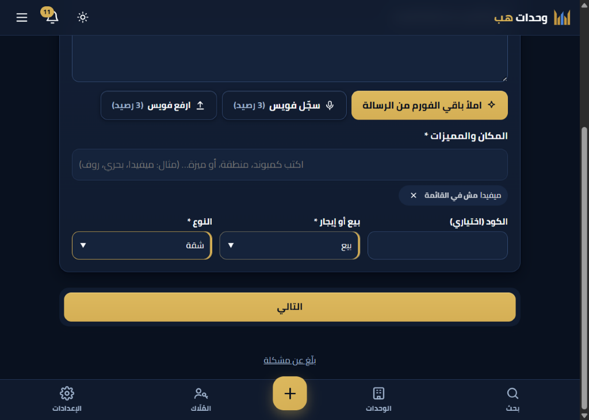
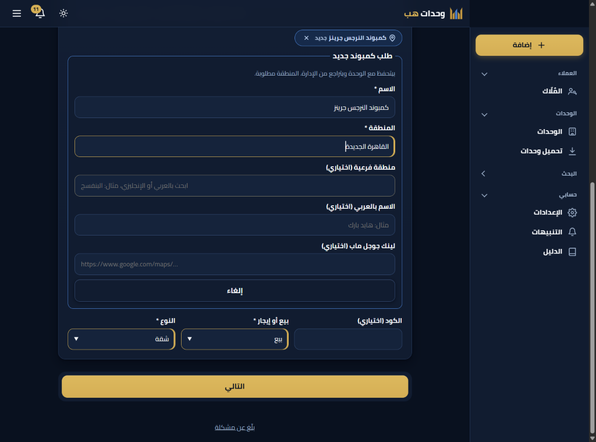
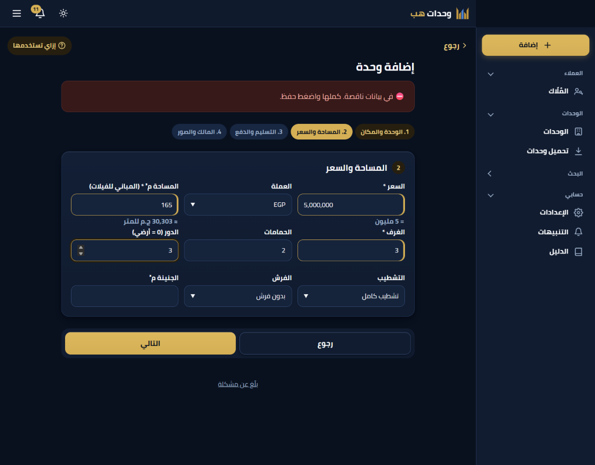
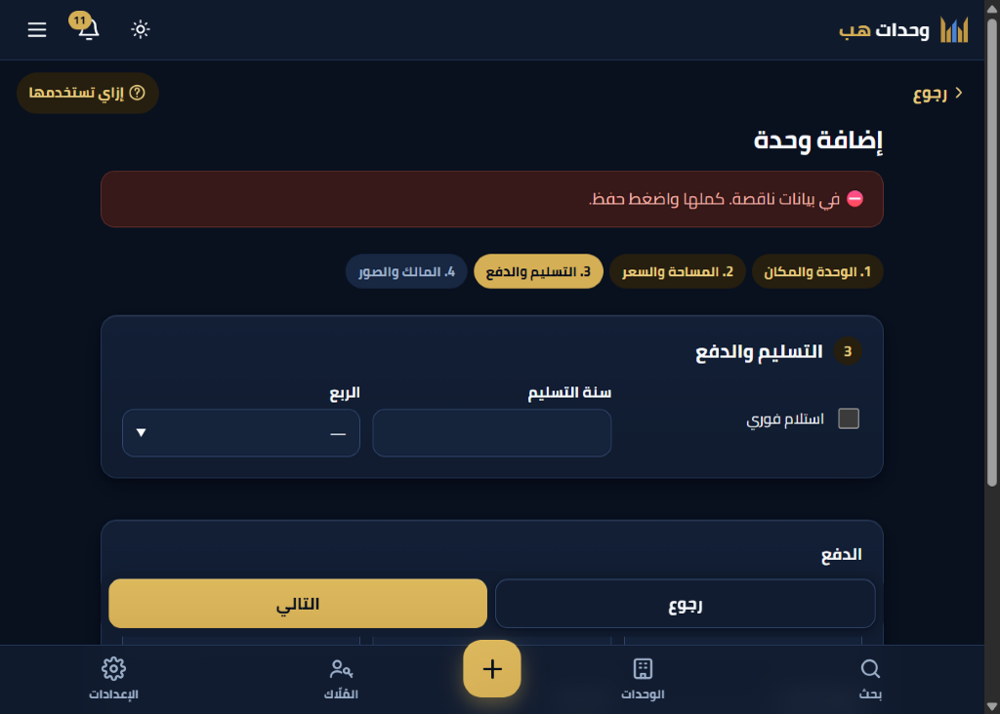
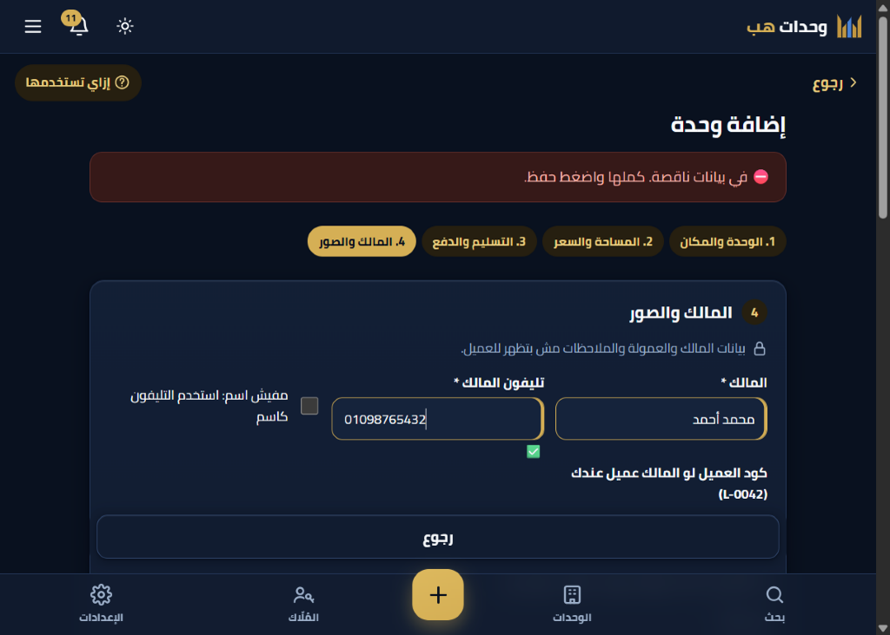
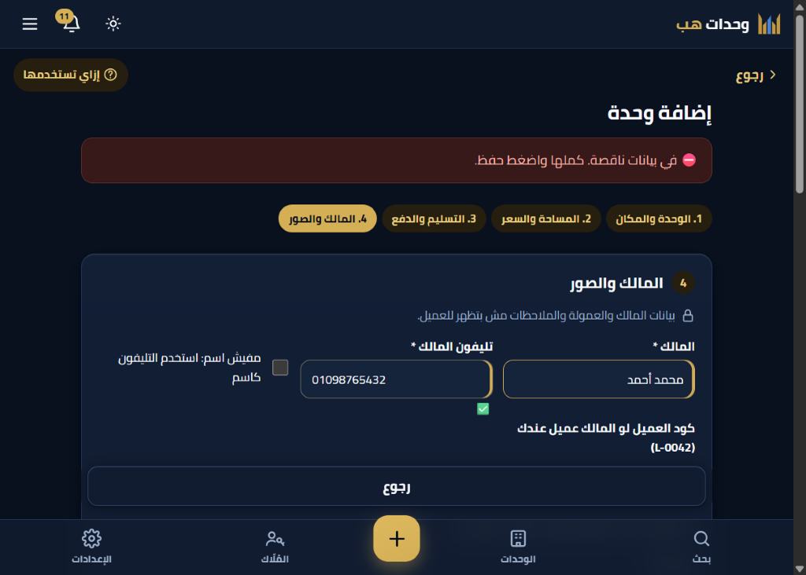
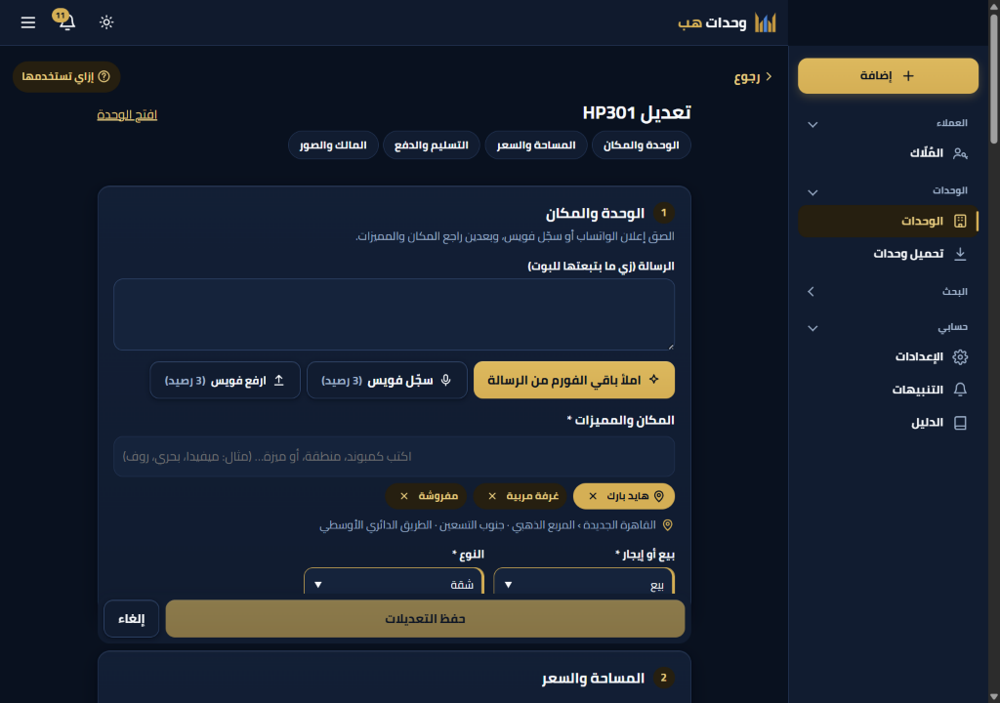
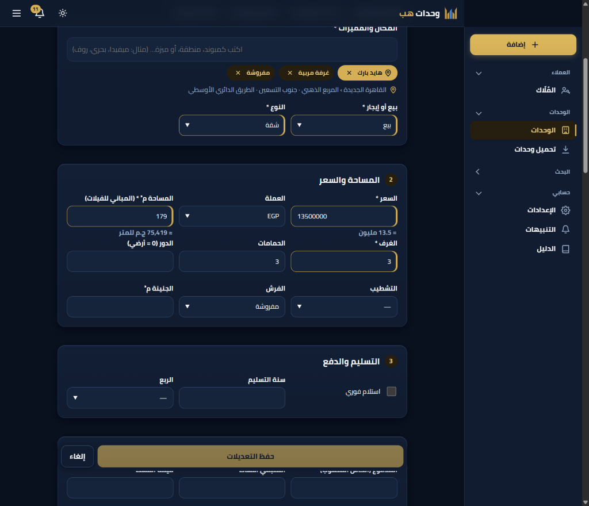
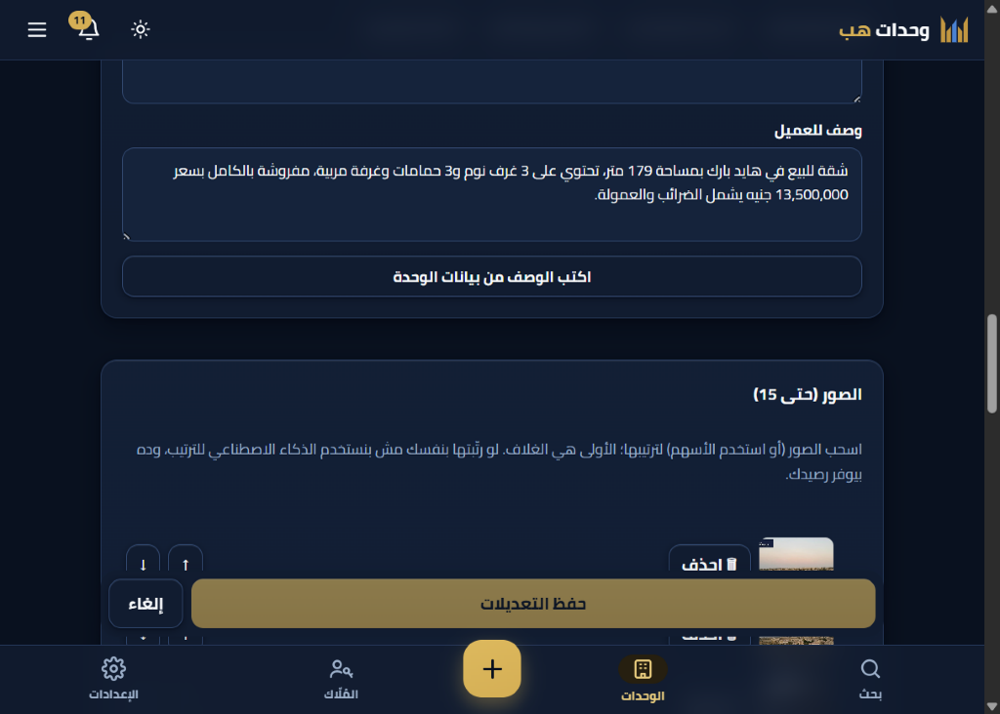
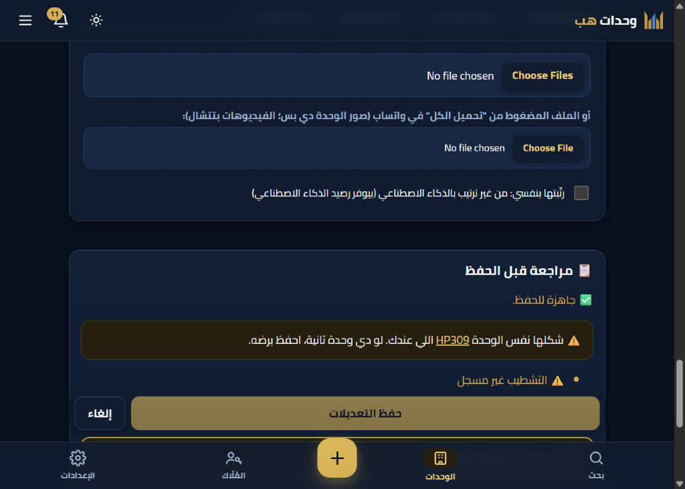

# Step-by-Step Beginner's Guide: Adding & Editing Units (Clear Steps with Examples)

Welcome to the **WehdatHub** user guide. This guide is crafted specifically for first-time and beginner users who want straightforward, clear instructions without technical jargon, walking through a complete real-world example from start to finish.

---

## 💡 Practical Example Used Throughout This Guide
Let's walk through adding a real apartment listing step by step:
* **Listing Type:** Apartment for Sale
* **Location:** Hyde Park Compound (Fifth Settlement - New Cairo)
* **Specifications:** 165 m², 3 Bedrooms, 2 Bathrooms, 3rd Floor, Fully Finished, Unfurnished
* **Price:** 5,500,000 EGP (Cash, Ready to Move)
* **Owner:** Mohamed Ahmed (Mobile: 01012345678)

---

## 🟢 Part 1: How to Add a New Unit (Add Unit Flow)

Open the unit creation page by clicking **➕ Add** (إضافة) or visiting the URL: `/app/units/new`.  
The form is organized into **4 simple sequential steps**:

---

### Step 1 of 4: Unit Type and Location

1. **Offer Type (نوع العرض):**
   * Click **Sale** (بيع) if the unit is for sale, or **Rent** (إيجار) if it is for rent.
2. **Unit Type (نوع الوحدة):**
   * Select the property type from the dropdown (e.g., **Apartment** / شقة, Villa, Townhouse, Duplex...).
3. **The Place & Features Box (Unified Box):**
   * Type the compound or neighborhood name (for example, type `Hyde Park` or `هايد بارك`).
   * A dropdown list will automatically show matching places with their regional hierarchy (e.g. *New Cairo › Golden Square*).
   * Click on the suggestion, and it will become a blue badge (Chip) under the box.
4. **Features (المميزات):**
   * In the same box, you can type special features (e.g. `Nanny room` or `غرفة مربية`, `Sea view`, `Garden`) to add them as removable chips.
5. Click the blue **Next** (التالي) button at the bottom of the screen.

> ### 📍 What if the Compound is Not in the List? (Request a New Compound)
> If you are adding a property in a brand new compound not yet listed (e.g. `El Narges Greens`):
> 1. Type the compound name in the Place box.
> 2. At the bottom of the dropdown suggestions, click: **"Request a new place: El Narges Greens"**.
> 3. An expanded new compound form opens with the following fields:
>    * **Name \*:** Pre-filled with the compound name you typed.
>    * **Area \* (Required):** Select the main city/area (e.g. `New Cairo` or `Sheikh Zayed`).
>    * **Sub-zone (Optional):** Select the neighborhood (e.g. `Al Narges`).
>    * **Arabic Name (Optional):** Arabic spelling of the compound.
>    * **Google Maps Link (Optional):** Link to the compound on Google Maps.
> 4. The compound is registered immediately with your listing so you can proceed to the next step!
>
> 

---

### Step 2 of 4: Size and Price

1. **Area in m² (المساحة):**
   * Enter the total built-up area in numbers (for our example: type `165`).
2. **Rooms, Bathrooms, and Floor:**
   * Click the button for number of bedrooms: click **3**.
   * Click the button for number of bathrooms: click **2**.
   * Click the button for the floor level: click **3**.
3. **Finishing and Furnishing:**
   * Select Finishing: choose **Fully Finished** (تشطيب كامل).
   * Select Furnishing: choose **Unfurnished** (بدون فرش).
4. **Price and Currency:**
   * Enter the total price in numbers: type `5500000`.
   * Check the currency: **EGP** (Egyptian Pounds) or choose USD / EUR if applicable.
5. Click the **Next** (التالي) button.

---

### Step 3 of 4: Delivery and Payment Terms

1. **Delivery Date (الاستلام):**
   * If the property is finished and ready for occupancy, check the box for **Immediate Delivery / Ready to Move** (استلام فوري).
   * If it is under construction, leave it unchecked and pick the estimated delivery year and quarter (e.g., 2026 Q3).
2. **Payment Method:**
   * **For Cash Deals:** Enter the full amount under *Required Cash Amount* (المدفوع كاش المطلوب) (e.g., `5500000`), and leave the installment fields blank.
   * **For Installment Plans:** Enter the down payment under Cash, enter remaining installments amount, select frequency (Monthly, Quarterly, Annually), and pick the final installment date.
3. Click the **Next** (التالي) button.

---

### Step 4 of 4: Owner, Photos, and Final Save

1. **Owner Details (Confidential Information):**
   * Owner Name: type `Mohamed Ahmed`.
   * Owner Mobile Number: type `01012345678`.
   > **🔒 Important Privacy Note:** The owner's phone number is confidential. It is only accessible to authorized team members and will **never** be shown to clients in shared links.
2. **Client Marketing Description:**
   * Click the button **✨ Write description from unit data** (اكتب الوصف من بيانات الوحدة). The system will automatically generate a clean, persuasive marketing message for buyers.
3. **Upload Photos:**
   * Click the photo upload box to select pictures from your phone or computer (up to 15 photos), or drag and drop image files directly into the box.
4. **Pre-Save Checklist:**
   * Click **📋 Review before saving** (مراجعة قبل الحفظ) to see a quick summary of all entered details and verify everything is correct.
5. **Final Save:**
   * Click the green **✅ Save** (حفظ) button.
   * 🎉 Congratulations! Your unit is saved and given an automatic unique code (such as `HP301`).

---

## 🔵 Part 2: How to Edit an Existing Unit (Edit Unit Flow)

Whenever you need to update a price, replace photos, or modify details of an existing listing:

1. Open the unit details page and click the **✏️ Edit** (تعديل) button.
2. The edit screen displays all cards with a quick navigation menu at the top:
   * **Location & Place**
   * **Size & Price**
   * **Delivery & Payment**
   * **Owner & Client Description**
   * **Photos & Review**

### 1. Updating Specifications or Price
Change any field directly (e.g., changing the asking price from 5M to 5.5M, or updating the status to Sold).

### 2. Organizing and Removing Photos
In the Photos section:
* Click the **↑** button to move a photo forward, or **↓** to move it back, so your best picture is positioned as the first (cover) photo.
* Click **Delete** (احذف) to remove any unwanted image.
* Upload new pictures whenever needed.

### 3. Duplicate Detection and Confirming Changes
* If the system detects a unit already in your company's inventory with the same compound, price, and rooms, a helpful yellow alert appears:  
  `⚠️ Looks like the same unit as HP309 in your inventory`
* If you have checked and wish to proceed, check the confirmation box:  
  ☑️ **I reviewed the warnings and want to save** (راجعت التنبيهات وعايز أحفظ)
* Click **Save Changes** (حفظ التعديلات).

---

## ❓ Frequently Asked Questions for Beginners (FAQ)

* **Q: Will clients ever see the owner's phone number?**  
  **A:** Never. Client links that you share only present public photos, property specifications, and pricing. Internal notes and owner contacts remain strictly private to your agency.
* **Q: What if I don't find the compound in the dropdown?**  
  **A:** Simply type the compound name and press Enter. The system will register it as a new compound in your agency account automatically.
* **Q: What does the yellow warning box mean?**  
  **A:** It is a smart check to alert you if another colleague already added the same property in your inventory, preventing duplicate listings.
* **Q: Can I edit the unit details later after saving?**  
  **A:** Yes, anytime! Simply open the unit card and click **✏️ Edit** to update prices, photos, or status.
