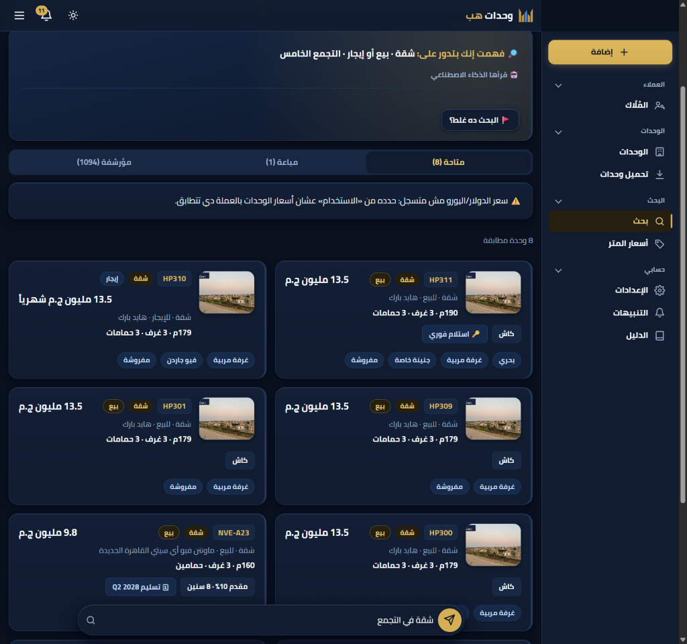
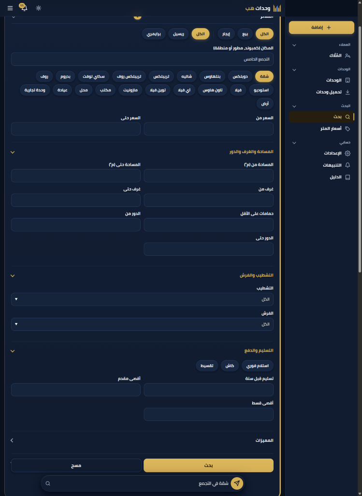

# دليل المبتدئين خطوة بخطوة: البحث عن الوحدات العقارية وتصفيتها (Search Guide)

دليل مصور يوضح كيفية البحث عن العقارات في موقع **WehdatHub** باستخدام الذكاء الاصطناعي، الأوامر الصوتية، أو الفلاتر المتقدمة، مع شرح استعراض النتائج وحفظ طلبات العملاء.

---

## 📌 الفهرس
1. [نظرة عامة على محرك البحث](#1-نظرة-عامة-على-محرك-البحث)
2. [البحث باللغة الطبيعية والذكاء الاصطناعي](#2-البحث-باللغة-الطبيعية-والذكاء-الاصطناعي)
3. [البحث الصوتي (Voice Search)](#3-البحث-الصوتي)
4. [استعراض نتائج البحث وحفظ البحث](#4-استعراض-نتائج-البحث-وحفظ-البحث)
5. [الفلاتر المتقدمة وتعديل البحث (Refine Filters)](#5-الفلاتر-المتقدمة-وتعديل-البحث)

---

## 1. نظرة عامة على محرك البحث

الرابط المباشر: `/app/search`

يوفر موقع WehdatHub محرك بحث موحد يعمل بنفس طريقة شات تيليجرام وواتساب، لكنه يعرض النتائج في واجهة مرئية واسعة تحتوي على صور واضحة وكروت تفاعلية لكل وحدة.

---

## 2. البحث باللغة الطبيعية والذكاء الاصطناعي

لا تحتاج لملء عشرات الحقول للبحث! فقط اكتب طلب العميل في شريط البحث كما تتحدث معه في الحقيقة:
* *أمثلة يمكنك كتابتها:*
  * `شقة في التجمع`
  * `شقة 3 غرف في هايد بارك تحت 9 مليون`
  * `فيلا للبيع في الشيخ زايد بالتقسيط استلام فوري`
  * `دوبلكس للإيجار في المعادي مفروش`

### كيف يفهم النظام طلبك؟
* يقوم محرك الذكاء الاصطناعي بقراءة الجملة وتفكيكها إلى شروط بحث دقيقة (النوع، المنطقة، عدد الغرف، الحد الأقصى للسعر، نظام الدفع).
* يظهر لك النظام ملخصاً فورياً لما فهمه، مثل:  
  `🔎 فهمت إنك بتدور على: شقة · بيع أو إيجار · التجمع الخامس · 🤖 قرأها الذكاء الاصطناعي`

---

## 3. البحث الصوتي

إذا كنت تستخدم الموبايل أو تفضل التحدث بدلاً من الكتابة:
1. اضغط على أيقونة **الميكروفون** (🎙️) المجاورة لشريط البحث.
2. تحدث بطلبك بوضوح (مثال: *"عايز شقة للبيع في التجمع الخامس ٣ غرف"*).
3. اضغط على الميكروفون مرة أخرى لإيقاف التسجيل.
4. سيتم تحويل صوتك فوراً إلى نص وتشغيل البحث مباشرة دون كتابة أي حرف!

---

## 4. استعراض نتائج البحث وحفظ البحث

### مميزات شاشة النتائج:
1. **كروت الوحدات:** تعرض لكل وحدة صورتها الرئيسية، كود الوحدة الداخلي (مثل `HP301`)، السعر والعملة، المساحة، عدد الغرف والحمامات، ومميزاتها البارزة.
2. **شريط تبديل الحالة (متاحة · مباعة · مؤرشفة):**
   * **متاحة:** الوحدات المعروضة حالياً في السوق.
   * **مباعة / مؤرشفة:** لمراجعة أسعار الوحدات السابقة ومعرفة متوسط أسعار التنفيذ السابقة في المنطقة.
3. **حفظ البحث (⭐ احفظ البحث):**
   * إذا كان العميل يبحث عن مواصفات غير متوفرة حالياً، اضغط على زر **⭐ احفظ البحث**.
   * سيقوم النظام بمراقبة المخزون، وبمجرد قيام أي زميل في شركتك بإضافة وحدة تطابق طلبك، سيصلك تنبيه فوري!

---

## 5. الفلاتر المتقدمة وتعديل البحث

لتحديد طلبات خاصة جداً، اضغط على زر **الفلاتر** أو **تعديل البحث** لفتح لوحة التصفية الشاملة:

### الخيارات المتاحة في لوحة الفلاتر:
* **نوع العرض:** بيع أو إيجار.
* **المكان والكمبوند:** تحديد كمبوند معين أو مدينة بالكامل.
* **نوع العقار:** شقة، فيلا، تاون هاوس، بنتهاوس، دوبلكس، أرض، تجاري...
* **نطاق السعر:** إدخال الحد الأدنى والحد الأقصى للسعر المطلوب.
* **المساحة والغرف والدور:** تحديد المساحة من/إلى بالمتر المربع، عدد الغرف، عدد الحمامات، ونطاق الأدوار.
* **التشطيب والفرش:** بدون تشطيب، نصف تشطيب، تشطيب كامل، ألترا سوبر لوكس، مفروشة بالكامل أو بدون فرش.
* **التسليم ونظام السداد:**
  * استلام فوري أو تحديد سنة الاستلام القصوى.
  * بيع كاش، أو تقسيط، مع إمكانية تحديد الحد الأقصى للمقدم والحد الأقصى للقسط الشهري.
* اضغط على زر **اعرض النتائج** في أسفل اللوحة لتطبيق الفلاتر وتحديث شاشة الوحدات فوراً.
