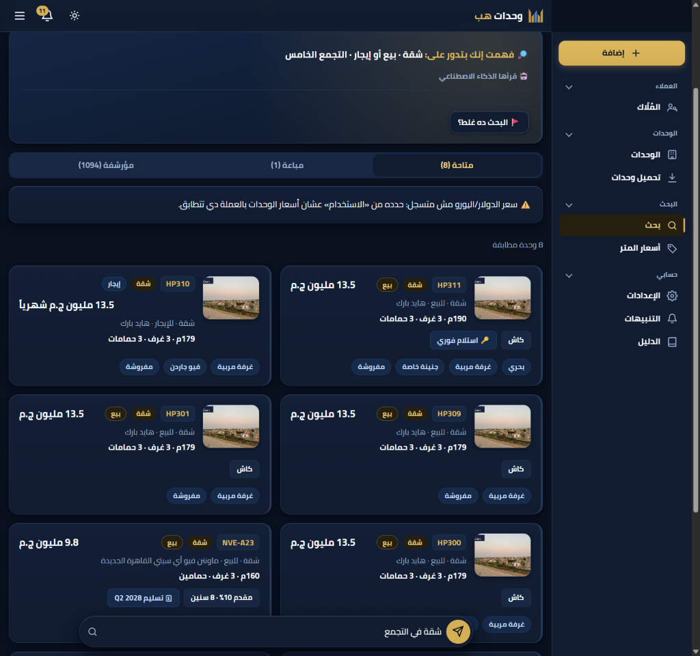
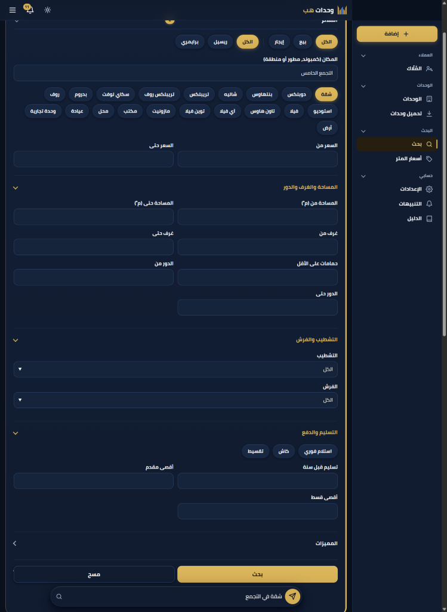

# Step-by-Step Beginner's Guide: Searching and Filtering Properties (Search Guide)

An illustrated, step-by-step guide explaining how to search for properties in **WehdatHub** using natural language AI, voice search, or advanced refine filters, along with saving client searches.

---

## 📌 Table of Contents
1. [Search Engine Overview](#1-search-engine-overview)
2. [Natural Language & AI Search](#2-natural-language--ai-search)
3. [Voice Search (Hands-Free)](#3-voice-search-hands-free)
4. [Browsing Results and Saving Searches](#4-browsing-results-and-saving-searches)
5. [Advanced Refine Filters](#5-advanced-refine-filters)

---

## 1. Search Engine Overview

Direct URL: `/app/search`

WehdatHub offers an omnichannel search engine that accepts queries written naturally, just like speaking to an assistant on WhatsApp or Telegram, but renders the inventory on a rich desktop/mobile interface with photos, specs, and status tabs.

---

## 2. Natural Language & AI Search

You don't need to manually configure dozens of filter inputs! Simply type the client's request in plain words:
* *Example queries you can type:*
  * `Apartment in New Cairo`
  * `3-bedroom flat in Hyde Park under 9M`
  * `Villa for sale in Sheikh Zayed with installments ready to move`
  * `Furnished duplex for rent in Maadi`

### How the AI Interprets Your Request:
* The system reads your query and extracts structured criteria: property type, target compound/city, bedroom count, maximum price, and payment terms.
* A live parsing banner shows what the AI understood:  
  `🔎 Understood: Apartment · Sale or Rent · New Cairo · 🤖 AI Parsed`

---

## 3. Voice Search (Hands-Free)

If you are on your mobile phone or prefer speaking:
1. Tap the **Microphone** (🎙️) icon next to the search bar.
2. Speak your request clearly (e.g., *"Looking for a 3-bedroom apartment for sale in Fifth Settlement"*).
3. Tap the microphone button again to stop recording.
4. Your speech is transcribed and searched immediately without typing a word.

---

## 4. Browsing Results and Saving Searches

### Key Features of the Results Screen:
1. **Property Cards:** Each card displays the primary photo, unique listing code (e.g., `HP301`), asking price, currency, area, bedroom/bathroom counts, and key feature badges.
2. **Status Tabs (Available · Sold · Archived):**
   * **Available (متاحة):** Currently active listings on the market.
   * **Sold / Archived (مباعة / مؤرشفة):** Historical transaction records useful for comparing historical market prices and advising clients.
3. **Save Search (⭐ احفظ البحث):**
   * If a client wants specific criteria that are not currently in your agency's inventory, click **⭐ Save Search**.
   * The system monitors new inventory and notifies you the instant a colleague adds a matching listing!

---

## 5. Advanced Refine Filters

To specify detailed, granular preferences, click the **Filters** (الفلاتر) or **Refine Search** button:

### Available Filter Controls:
* **Offer Type:** Sale or Rent.
* **Compound & Location:** Restrict search to a specific compound or whole municipality.
* **Property Type:** Apartment, Villa, Townhouse, Penthouse, Duplex, Land, Commercial...
* **Price Range:** Minimum and maximum budget limits.
* **Size & Rooms:** Area from/to in m², number of bedrooms, bathrooms, and floor level.
* **Finishing & Furnishing:** Core & Shell, Semi-Finished, Fully Finished, Ultra Super Lux, Furnished, or Unfurnished.
* **Delivery & Payment Terms:**
  * Ready to move (immediate delivery) or maximum delivery year.
  * Cash deals or installment plans, with maximum down payment and monthly installment caps.
* Click the blue **Show Results** (اعرض النتائج) button at the bottom to apply filters and refresh the listing feed immediately.
